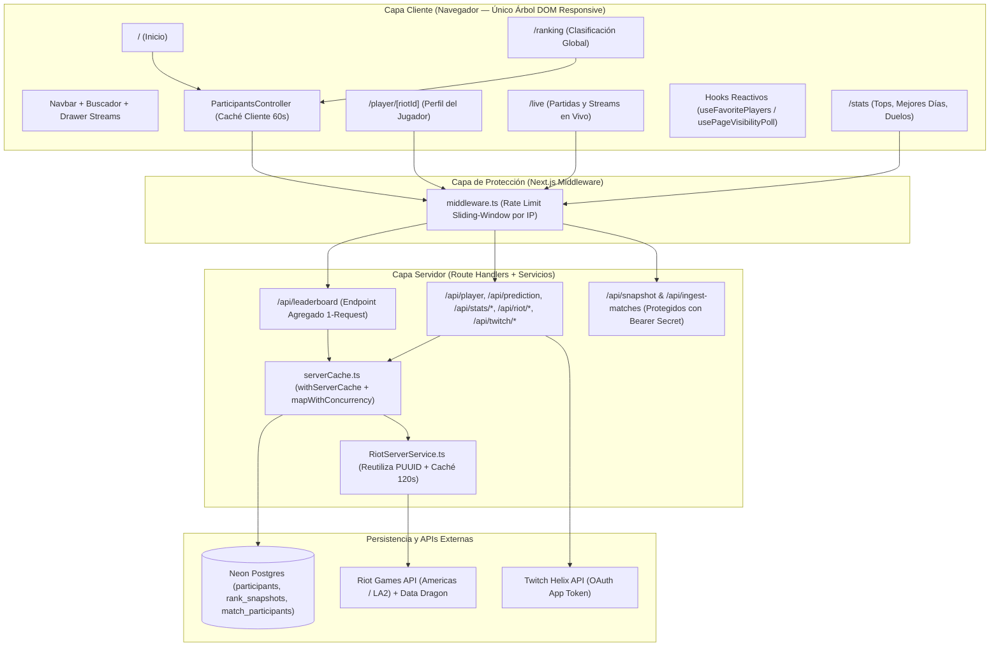
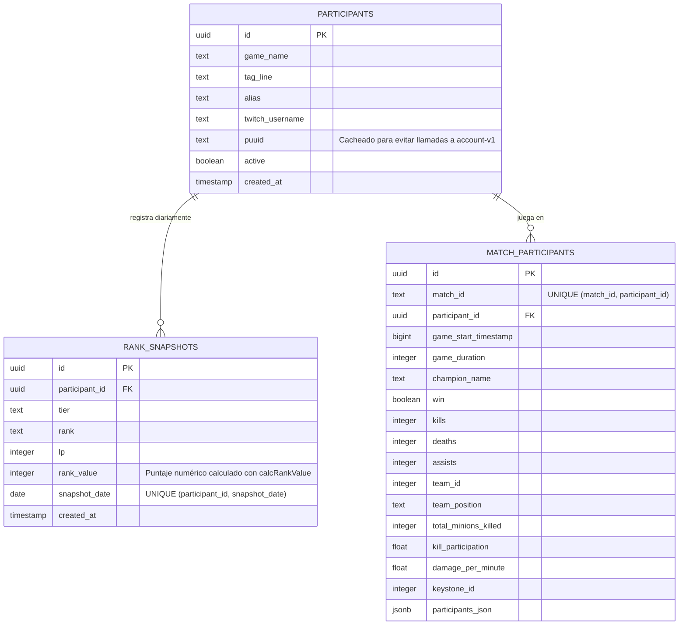
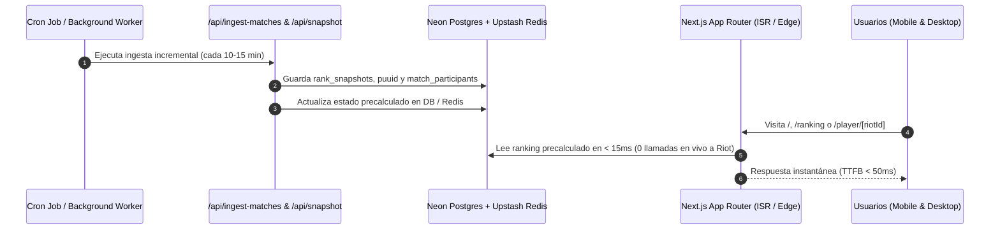

# Guía de Arquitectura, Flujo de Trabajo y Escalabilidad — SoloGae Challenge

Este documento describe la arquitectura actual de **SoloGae Challenge** (Next.js 15 App Router + React 19 + Neon Serverless Postgres + Riot Games & Twitch APIs), las reglas de oro para agregar nuevas funcionalidades sin degradar el rendimiento, y la hoja de ruta técnica para escalar el proyecto a múltiples torneos, divisiones y miles de usuarios concurrentes.

---

## 1. Visión General de la Arquitectura

El proyecto sigue una arquitectura **Multi-Página en Next.js App Router** respaldada por una capa de protección y agregación en el servidor (**Middleware Rate Limiting + Server Cache Coalescing + Concurrency Limiter**) para proteger la cuota de `RIOT_API_KEY` y acelerar la respuesta al cliente.



> [!IMPORTANT]
> **Regla de Oro contra el Rate Limit (`429`):** Ningún componente ni ruta debe hacer `Promise.all` masivos sin límite hacia Riot API. Toda consulta en lote debe pasar por [`mapWithConcurrency`](file:///d:/workspaces/SoloGae-Challenge-Next/src/lib/serverCache.ts#L59-L83) (máximo 4 peticiones simultáneas) y envolverse en [`withServerCache`](file:///d:/workspaces/SoloGae-Challenge-Next/src/lib/serverCache.ts#L22-L54).

---

## 2. Modelo de Datos (Base de Datos en Neon Postgres)

El esquema relacional se inicializa y migra de forma idempotente en [`route.ts`](file:///d:/workspaces/SoloGae-Challenge-Next/app/api/setup/route.ts) a través del cliente [`db.ts`](file:///d:/workspaces/SoloGae-Challenge-Next/src/lib/db.ts).



---

## 3. Estructura de Directorios y Responsabilidades

| Ruta | Responsabilidad | Archivos Clave |
| :--- | :--- | :--- |
| `middleware.ts` | Intercepta todas las rutas `/api/:path*` aplicando Rate Limiting por IP (`60 req/min` público, `5 req/min` admin) y cabeceras `X-RateLimit-*`. | [`middleware.ts`](file:///d:/workspaces/SoloGae-Challenge-Next/middleware.ts), [`rateLimit.ts`](file:///d:/workspaces/SoloGae-Challenge-Next/src/lib/rateLimit.ts) |
| `app/` | Páginas del App Router (`01. Inicio`, `02. Ranking`, `03. Perfil del jugador`, `/live`, `/stats`), estilos globales y estados de error/404. | [`layout.tsx`](file:///d:/workspaces/SoloGae-Challenge-Next/app/layout.tsx), [`globals.css`](file:///d:/workspaces/SoloGae-Challenge-Next/app/globals.css), [`page.tsx`](file:///d:/workspaces/SoloGae-Challenge-Next/app/page.tsx), [`page.tsx` (Ranking)](file:///d:/workspaces/SoloGae-Challenge-Next/app/ranking/page.tsx), [`page.tsx` (Perfil)](file:///d:/workspaces/SoloGae-Challenge-Next/app/player/%5BriotId%5D/page.tsx) |
| `app/api/` | Route Handlers de servidor con caché en memoria + cabeceras `Cache-Control: s-maxage, stale-while-revalidate`. | [`route.ts` (leaderboard)](file:///d:/workspaces/SoloGae-Challenge-Next/app/api/leaderboard/route.ts), [`route.ts` (player)](file:///d:/workspaces/SoloGae-Challenge-Next/app/api/player/route.ts), [`route.ts` (prediction)](file:///d:/workspaces/SoloGae-Challenge-Next/app/api/prediction/route.ts), [`route.ts` (ingest-matches)](file:///d:/workspaces/SoloGae-Challenge-Next/app/api/ingest-matches/route.ts) |
| `src/components/` | Componentes UI modulares bajo el sistema de diseño SOLOGAE (`04. Sistema de diseño`). | [`Navbar`](file:///d:/workspaces/SoloGae-Challenge-Next/src/components/Navbar/index.tsx), [`ParticipantsTable`](file:///d:/workspaces/SoloGae-Challenge-Next/src/components/ParticipantsTable/index.tsx), [`PlayerProfile`](file:///d:/workspaces/SoloGae-Challenge-Next/src/components/PlayerProfile/index.tsx), [`LiveGamesPage`](file:///d:/workspaces/SoloGae-Challenge-Next/src/components/LiveGamesPage/index.tsx), [`StatsPage`](file:///d:/workspaces/SoloGae-Challenge-Next/src/components/StatsPage/index.tsx) |
| `src/hooks/` | Hooks reactivos de estado compartido y ciclo de vida del navegador. | [`usePageVisibilityPoll.ts`](file:///d:/workspaces/SoloGae-Challenge-Next/src/hooks/usePageVisibilityPoll.ts), [`useFavoritePlayers.ts`](file:///d:/workspaces/SoloGae-Challenge-Next/src/hooks/useFavoritePlayers.ts) |
| `src/lib/` & `src/services/` | Infraestructura de base de datos, caché de servidor, rate limiter y clientes de Riot/Twitch. | [`serverCache.ts`](file:///d:/workspaces/SoloGae-Challenge-Next/src/lib/serverCache.ts), [`RiotServerService.ts`](file:///d:/workspaces/SoloGae-Challenge-Next/src/services/RiotServerService.ts), [`ParticipantsController.ts`](file:///d:/workspaces/SoloGae-Challenge-Next/src/controllers/ParticipantsController.ts) |
| `src/utils/` | Funciones puras de dominio (cálculo de Elo/Rank, ordenamiento, URLs de jugador, winrate) con 100% de cobertura unitaria. | [`calcRankValue.ts`](file:///d:/workspaces/SoloGae-Challenge-Next/src/utils/calcRankValue.ts), [`sortByRank.ts`](file:///d:/workspaces/SoloGae-Challenge-Next/src/utils/sortByRank.ts), [`playerUrl.ts`](file:///d:/workspaces/SoloGae-Challenge-Next/src/utils/playerUrl.ts) |

---

## 4. Cómo Trabajar y Agregar Nuevas Funcionalidades (Guía Paso a Paso)

### 4.1. Comandos Oficiales del Flujo de Trabajo (`pnpm`)
Todo el ciclo de desarrollo, testing y despliegue utiliza exclusivamente **`pnpm`**:

```bash
# 1. Levantar entorno de desarrollo
pnpm dev

# 2. Ejecutar suite completa de pruebas (Vitest + Testing Library)
pnpm test

# 3. Verificar tipos TypeScript y reglas de ESLint
pnpm exec tsc --noEmit
pnpm lint

# 4. Compilar versión de producción y auditar peso de rutas (First Load JS)
pnpm build
```

---

### 4.2. Receta 1: Cómo agregar un nuevo Endpoint API (`/api/...`)
Cuando necesites exponer nueva información desde Neon Postgres o Riot API:

1. **Crea el archivo `app/api/<recurso>/route.ts`**.
2. **Envuelve la consulta costosa en [`withServerCache`](file:///d:/workspaces/SoloGae-Challenge-Next/src/lib/serverCache.ts#L22-L54)** definiendo una clave única y un TTL adecuado:
   - `45s–60s` para datos en vivo (Spectator / Twitch Live).
   - `180s–300s` para estadísticas de partidas, perfiles o ranking.
   - `600s+` para snapshots diarios que solo cambian una vez al día.
3. **Incluye cabeceras `Cache-Control`** (`s-maxage` + `stale-while-revalidate`) en el `NextResponse.json` para aprovechar también la caché Edge de Vercel.
4. **Si el endpoint no recibe parámetros de URL**, exporta `export async function GET()` (sin argumentos opcionales `req?: NextRequest`, ya que el tipado estricto de Next.js 15 exige `GET()` o `GET(req: NextRequest)`). El rate limiting por IP ya actúa automáticamente desde [`middleware.ts`](file:///d:/workspaces/SoloGae-Challenge-Next/middleware.ts).

```typescript
import { NextResponse } from "next/server"
import sql from "@/lib/db"
import { withServerCache } from "@/lib/serverCache"

export async function GET() {
  const data = await withServerCache("api:mi-nuevo-recurso", 300, async () => {
    return sql`SELECT ... FROM match_participants WHERE ...`
  })

  return NextResponse.json(data, {
    headers: { "Cache-Control": "public, s-maxage=300, stale-while-revalidate=600" },
  })
}
```

> [!TIP]
> En entorno de pruebas (`pnpm test`), `withServerCache` detecta automáticamente `process.env.VITEST` y omite la caché en memoria para que cada test unitario sea 100% independiente sin necesidad de limpiar estado global manualmente.

---

### 4.3. Receta 2: Cómo agregar una nueva Página o Vista UI (`04. Sistema de diseño`)
Para mantener la consistencia visual y el rendimiento en mobile y desktop:

1. **Usa las clases base y variables CSS de [`app/globals.css`](file:///d:/workspaces/SoloGae-Challenge-Next/app/globals.css):**
   - Contenedor principal: `<main className="sg-container">`
   - Tarjetas: `.sg-card` (`background: var(--bg2)`, `border: 1px solid var(--border)`, `border-radius: var(--radius-lg)`)
   - Botones: `.sg-btn .sg-btn-primary` (turquesa `#00E5C2`), `.sg-btn-secondary` (outline), `.sg-btn-purple` (`#7C3AED`)
   - Badges: `.sg-badge-teal`, `.sg-badge-purple`, `.sg-badge-coral`, `.sg-badge-gold`
   - Fuentes: `var(--font-sans)` (`Inter`) para texto general y `var(--font-display)` (`Rajdhani`) para números, LP, KDA y titulares.
2. **Responsive Real (Prohibido duplicar árboles DOM):**
   - Nunca crees versiones `.desktop-only` y `.mobile-only` del mismo componente.
   - Usa CSS Grid (`grid-template-columns: repeat(auto-fit, minmax(..., 1fr))`) o transforma tablas en tarjetas en `@media (max-width: 768px)` usando `data-label` como en [`ParticipantsTable/styles.css`](file:///d:/workspaces/SoloGae-Challenge-Next/src/components/ParticipantsTable/styles.css#L656-L782).
3. **Si la vista incluye librerías pesadas (como `recharts`):**
   - Extrae el gráfico a un subcomponente y cárgalo con `next/dynamic(..., { ssr: false })` como en [`TrendChart.tsx`](file:///d:/workspaces/SoloGae-Challenge-Next/src/components/PlayerProfile/TrendChart.tsx) para mantener el *First Load JS* por debajo de ~115 kB.
4. **Si la vista necesita refresco periódico (Polling):**
   - Usa siempre [`usePageVisibilityPoll`](file:///d:/workspaces/SoloGae-Challenge-Next/src/hooks/usePageVisibilityPoll.ts) en lugar de `setInterval` crudo. Así el polling se pausa automáticamente cuando la pestaña pasa a segundo plano y cancela peticiones pendientes con `AbortController`.

---

## 5. Hoja de Ruta para Escalar el Proyecto (Siguientes Niveles)

A medida que crezca la cantidad de participantes, espectadores simultáneos o ediciones del torneo, esta es la ruta técnica recomendada en orden de impacto:



### Nivel 1: Desacoplar por completo a Riot API del tráfico de usuarios (DB-First Leaderboard)
- **Situación actual:** Aunque [`/api/leaderboard`](file:///d:/workspaces/SoloGae-Challenge-Next/app/api/leaderboard/route.ts) cachea la respuesta en el servidor durante 60 segundos, cuando la caché expira la primera petición de usuario consulta la liga de cada participante en Riot API.
- **Cómo escalarlo:** Agregar las columnas `current_tier`, `current_rank`, `current_lp`, `current_wins`, `current_losses`, `in_game` y `ranked_updated_at` directamente en la tabla `participants`. Un Cron Job cada 3–5 minutos actualiza esa tabla en segundo plano, y `/api/leaderboard` lee **únicamente de Neon Postgres** en `< 10 ms`. Así el sitio puede recibir **10.000 usuarios simultáneos** sin consumir ni 1 request adicional de `RIOT_API_KEY`.

### Nivel 2: Caché Distribuida y Rate Limiting Global (Upstash Redis / Vercel KV)
- **Situación actual:** [`rateLimit.ts`](file:///d:/workspaces/SoloGae-Challenge-Next/src/lib/rateLimit.ts) y [`serverCache.ts`](file:///d:/workspaces/SoloGae-Challenge-Next/src/lib/serverCache.ts) viven en la memoria del proceso Node/Edge (`Map`), lo cual es ideal y gratuito para una instancia o despliegue estándar.
- **Cómo escalarlo:** Si el proyecto escala a múltiples regiones o decenas de instancias serverless paralelas en Vercel, basta con reemplazar el `Map` interno de [`serverCache.ts`](file:///d:/workspaces/SoloGae-Challenge-Next/src/lib/serverCache.ts) y [`rateLimit.ts`](file:///d:/workspaces/SoloGae-Challenge-Next/src/lib/rateLimit.ts) por `@upstash/redis` y `@upstash/ratelimit`, sin cambiar ni una línea en los Route Handlers ni en los componentes.

### Nivel 3: Soporte Multi-Torneo y Multi-Temporada (`seasons` / `tournaments`)
- **Situación actual:** Las fechas del evento están en [`events.ts`](file:///d:/workspaces/SoloGae-Challenge-Next/src/constants/events.ts).
- **Cómo escalarlo:** Crear una tabla `tournaments (id, slug, name, start_date, end_date, prize_per_player, active)` y asociar `tournament_id` a `rank_snapshots` y `match_participants`. Esto permitirá conservar el archivo histórico de temporadas pasadas (`/ranking?season=2026-1`, `/ranking?season=2026-2`) y gestionar participantes desde un panel de administración sin tocar código.

### Nivel 4: Autenticación Real y Predicciones de la Comunidad (NextAuth / Auth.js)
- **Situación actual:** Los botones `Iniciar sesión` y `Regístrate` de [`Navbar/index.tsx`](file:///d:/workspaces/SoloGae-Challenge-Next/src/components/Navbar/index.tsx) están preparados en la UI y los favoritos se guardan en `localStorage` mediante [`useFavoritePlayers.ts`](file:///d:/workspaces/SoloGae-Challenge-Next/src/hooks/useFavoritePlayers.ts).
- **Cómo escalarlo:** Conectar **Auth.js (NextAuth v5)** con proveedor de **Twitch / Discord / Riot Sign-On (RSO)** para permitir que los espectadores voten en la **Predicción del Ganador**, sincronicen sus jugadores seguidos en la nube y participen en desafíos comunitarios.
